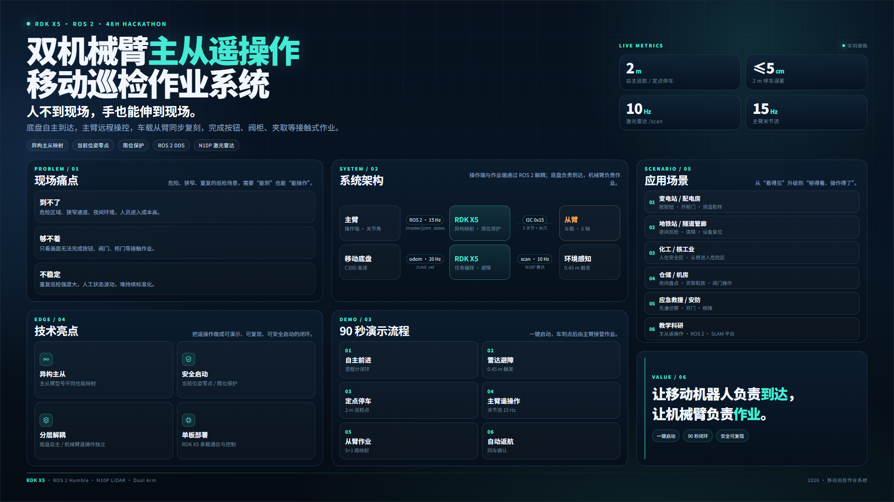

# 双机械臂主从遥操作移动巡检作业系统

> 移动底盘 + 车载从臂，由操作端主臂实时主从映射完成接触式点检；底盘按里程计航点自主驶入巡检点位，激光雷达负责急停与绕障，车载相机把现场画面实时回传到远端操作台。



## 1. 项目概览

| 维度 | 方案 |
| --- | --- |
| 移动平台 | WHEELTEC L150Pro 差速底盘（C30D V2.0 STM32 控制器） |
| 主控 | RDK X5，Ubuntu 22.04 + TROS Humble / ROS 2 Humble |
| 感知 | N10P 串口激光雷达 + C70 USB 相机（车头）+ 从臂末端相机 |
| 机械臂 | 主臂 Panthera-HT（6 DOF，操作端）；从臂 Dofbot（6 DOF + 夹爪，车载） |
| 主从链路 | ROS 2 话题 `/master/joint_states`，操作端读主臂角度，车端映射到从臂 I2C 舵机 |
| 底盘任务 | `odom` 航点直行 → 到点停车 → 主从遥操作 → 回车返航 |
| 避障 | `/scan` 前向扇区急停 + 侧向绕行，不依赖地图 |
| 图传 | MJPEG over HTTP（`mjpeg_server.py`），浏览器直接看 |

**为什么不用 SLAM/AMCL 做最终演示：** 现场是空旷场地，缺少稳定特征，建图与重定位不可靠。因此最终链路采用 `odom` 航点 + 激光雷达急停的 B 案；Nav2/AMCL 的完整启动脚本仍保留在仓库中，用于有走廊/机柜结构的场地。

## 2. 系统架构

```text
┌─────────────── 操作端 ───────────────┐        ┌──────────────── 车端（RDK X5）────────────────┐
│  主臂 Panthera-HT                    │        │  从臂 Dofbot（I2C 0x15，5 舵机 + 夹爪）        │
│  master_joint_node.py                │  WiFi  │  slave_joint_node.py                          │
│    /master/joint_states  ────────────┼───────►│    订阅 /master/joint_states → 舵机角度         │
│    /master/gripper       ────────────┼───────►│    夹爪开合映射                                │
│                                      │        │                                               │
│  浏览器 ◄──── MJPEG :8080/:8081 ─────┼────────┤  mjpeg_server.py（车头 C70 / 末端相机）        │
└──────────────────────────────────────┘        │                                               │
                                                │  odom_mission.py                              │
                                                │    /odom → 航点闭环                            │
                                                │    /scan → 前向急停 + 绕障                     │
                                                │    /cmd_vel → C30D 底盘                       │
                                                └───────────────────────────────────────────────┘
```

## 3. 仓库结构

```text
.
├── arms/bridge/              # 机械臂与任务侧全部脚本（部署到车端 ~/）
│   ├── master_joint_node.py  # 主臂 → /master/joint_states
│   ├── slave_joint_node.py   # 主从映射 → 从臂舵机（I2C）
│   ├── odom_mission.py       # 里程计航点 + 雷达避障 + 到点动作
│   ├── mjpeg_server.py       # 图传
│   ├── run_full_demo.sh      # 车端一键：从臂 + 底盘 + 任务
│   ├── run_open_demo.sh      # 空旷场地一键
│   ├── run_demo.sh           # 底盘 + 雷达 bringup
│   └── color_grab.py / pick_rear.py / arm_teach.py ...  # 视觉抓取与示教（实验分支）
├── robot_ws/
│   ├── src/robot_base/       # C30D 底盘驱动（24 字节反馈 / 11 字节命令）
│   ├── src/robot_bringup/    # 底盘 + 雷达 + 相机一键启动、udev、systemd
│   ├── src/robot_description/# URDF 与 TF
│   ├── src/robot_navigation/ # Nav2 启动封装（非最终演示链路）
│   ├── src/robot_mission/    # 巡检状态机（非最终演示链路）
│   ├── src/robot_perception/ # 火烟检测（非最终演示链路）
│   ├── src/third_party/      # N10P 雷达厂家驱动（Apache-2.0）
│   ├── docs/                 # 开发日志与检查清单
│   └── tools/                # 环境检查脚本
├── course/                   # ROS 2 入门课程网页
├── poster/                   # 项目海报
├── report/                   # 项目报告（PDF + 网页版）
└── maps/                     # 建图结果截图
```

## 4. 快速开始

### 4.1 车端依赖

```bash
source /opt/tros/humble/setup.bash

sudo apt install -y i2c-tools python3-smbus python3-opencv \
  ros-humble-usb-cam ros-humble-cv-bridge ros-humble-vision-msgs \
  ros-humble-nav2-bringup ros-humble-slam-toolbox
```

### 4.2 编译工作区

```bash
cd ~/robot_ws
source /opt/tros/humble/setup.bash
colcon build --symlink-install
source install/setup.bash
```

### 4.3 固定串口

```bash
sudo cp ~/robot_ws/src/robot_bringup/udev/99-wheeltec.rules /etc/udev/rules.d/
sudo udevadm control --reload-rules
sudo udevadm trigger
ls -l /dev/wheeltec_*
```

应看到 `/dev/wheeltec_lidar` 和 `/dev/wheeltec_controller`。

### 4.4 部署脚本到车端

```bash
scp arms/bridge/*.py arms/bridge/*.sh sunrise@<车端IP>:~/
```

### 4.5 启动主臂端（操作台）

```bash
source /opt/ros/humble/setup.bash
export ROS_DOMAIN_ID=0
python3 ~/master_joint_node.py --ros-args \
  -p config_path:=$HOME/arms/Panthera-HT_SDK/panthera_python/robot_param/Leader.yaml
```

### 4.6 车端一键演示

```bash
# 从臂 + 底盘 + 雷达 + 图传 + 前进任务
GRIP=1 bash ~/run_full_demo.sh

# 只跑底盘（从臂未就绪时）
GRIP=0 DISTANCE=2.0 SPEED=0.08 bash ~/run_full_demo.sh
```

## 5. 分步启动（便于排障）

```bash
source /opt/tros/humble/setup.bash
source /opt/ros/humble/setup.bash
source ~/robot_ws/install/setup.bash
export ROS_DOMAIN_ID=0

# 1) 底盘 + 雷达 + 相机
bash ~/run_demo.sh

# 2) 从臂映射（第二关节反向，夹爪随动）
python3 ~/slave_joint_node.py --ros-args \
  -p scale:=0.3 -p verbose:=true \
  -p grip_index:=6 -p grip_sign:=-1.0 -p grip_span:=500 \
  -p signs:="[1.0,-1.0,1.0,1.0,1.0]"

# 3) 任务：前进 2 m，到点停车等待，按回车返航
python3 ~/odom_mission.py --ros-args \
  -p target_x:=2.0 -p target_y:=0.0 -p target_yaw:=0.0 \
  -p max_linear:=0.08 -p front_stop:=0.50 \
  -p avoid_turn_deg:=75.0 -p front_half_angle:=0.45 \
  -p arm_demo:=true
```

常用参数：

| 参数 | 作用 |
| --- | --- |
| `target_x` / `target_y` / `target_yaw` | 目标点（米 / 弧度，`odom` 坐标系） |
| `max_linear` | 最大线速度，演示建议 `0.08` |
| `front_stop` | 前向急停距离，演示 `0.45 ~ 0.50` |
| `front_half_angle` | 前向扇区半角（弧度） |
| `avoid_turn_deg` | 遇障转向角度 |
| `arm_demo` | 到点后执行机械臂动作脚本 |

从臂映射参数：

| 参数 | 作用 |
| --- | --- |
| `scale` | 主从幅度比例，调试 `0.15`，演示 `0.3~0.6` |
| `signs` | 五个关节方向；本机第二关节为 `-1.0` |
| `grip_index` | 夹爪在主臂数组中的下标；`99` 表示不映射夹爪 |
| `grip_span` / `grip_sign` | 夹爪开合行程与方向 |
| `dry_run` | 只打印不驱动，接线排障用 |

## 6. 视觉抓取分支

`color_grab.py`、`pick_rear.py`、`yolo_pick.py` 为末端颜色/YOLO 抓取实验代码。它们没有进入最终主从演示链路，原因是末端相机与夹爪存在约 5.5 cm 光心偏差，标定后仍需要在工位固定摆放才能稳定抓取。代码保留供后续迭代。

## 7. 当前状态

| 模块 | 状态 |
| --- | --- |
| C30D 底盘驱动、`/odom`、`/scan` | 已跑通 |
| `odom` 航点直行 + 雷达急停/绕障 | 已跑通 |
| 主臂 → `/master/joint_states` | 已跑通 |
| 从臂主从映射（含夹爪） | 已跑通 |
| 双路 MJPEG 图传 | 已跑通 |
| 到点机械臂动作（示教位姿回放） | 已跑通 |
| 末端相机自主识别 + 抓取 | 实验，未进最终演示 |
| Nav2 / AMCL 全局规划 | 脚本完整，现场空旷未启用 |
| 火烟检测 | 代码完整，未进最终演示 |

## 8. 安全提醒

- 从臂启动时以当前位姿为零点，**不要按 K1 当零位**。
- 主臂节点退出前先扶住主臂，避免掉电自由下落。
- 上电顺序：扩展板 12V → RDK X5 → 启动节点；`i2cdetect` 看不到 `0x15` 不要强行启动。
- 演示前确认车头前方 2 m 内无人、无障碍。
- 夹爪长时间堵转会发热，出现异响立即断电。

## 9. 后续优化

下一步会把定位从纯 `odom` 升级为「激光 SLAM 建图 + AMCL 重定位 + Nav2 全局规划」的完整自主导航，用多传感器融合（轮式里程计 + IMU + 激光）抑制长距离累积误差，并加入动态障碍物预测与社会化避障策略；机械臂侧将用眼在手标定替代固定示教位姿，把末端相机的像素误差映射到关节空间，实现任意摆放的自主识别抓取，同时接入 YOLO/BPU 量化模型提升实时性；系统层面补充 ROS 2 生命周期管理、任务状态机、断连重连与远程急停，并增加 5G/WiFi 链路质量监测，让主从遥操作在真实机房、地铁站等场景下具备连续作业能力。

## 10. 第三方与许可

- 本项目自有代码采用 [MIT License](LICENSE)。
- `robot_ws/src/third_party/lslidar_driver`、`lslidar_msgs` 为 N10P 雷达厂家驱动，遵循 **Apache-2.0**，版权归原作者所有，未做修改或仅做适配。
- `Panthera-HT_SDK`（主臂 SDK）与 WHEELTEC 底盘资料未随仓库分发，请向厂商获取。
- 火烟检测权重 `fire_smoke_yolov8n.pt` 未入库（见 `.gitignore`），需要时放入 `robot_ws/models/`。

## 11. 演示材料

- 海报：[poster/index.html](poster/index.html) / [poster.png](poster/poster.png)
- 项目报告：[report/report.pdf](report/report.pdf) / [网页版](report/index.html)
- ROS 2 入门课程：[course/index.html](course/index.html)
